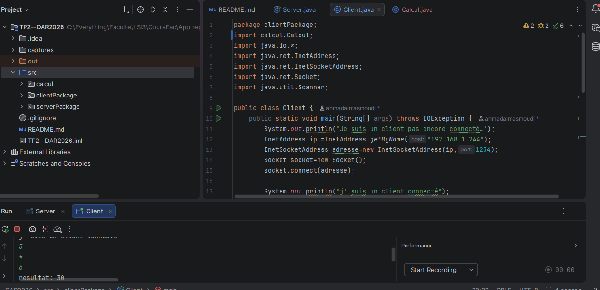
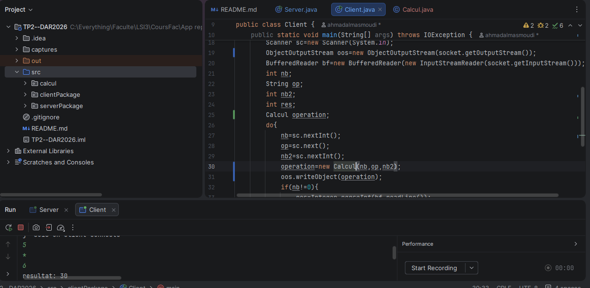
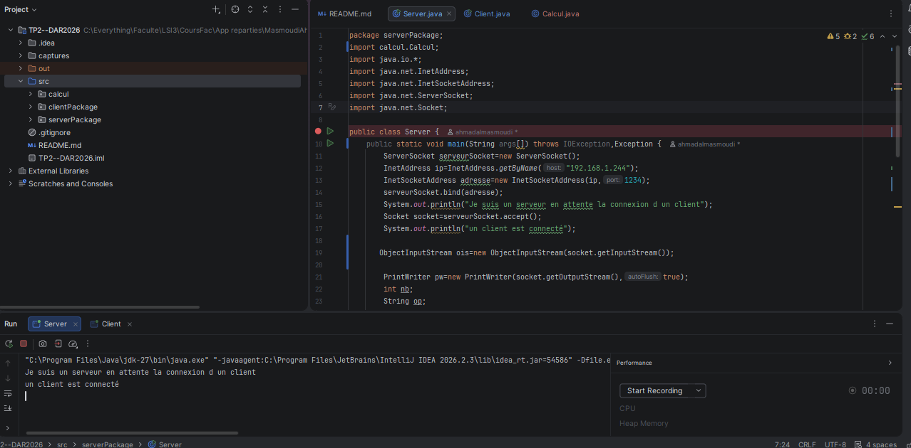
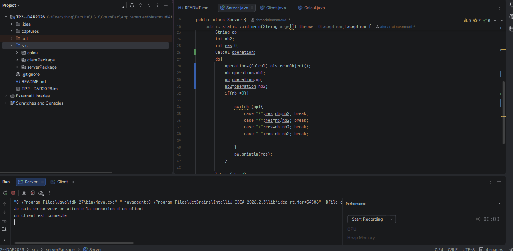
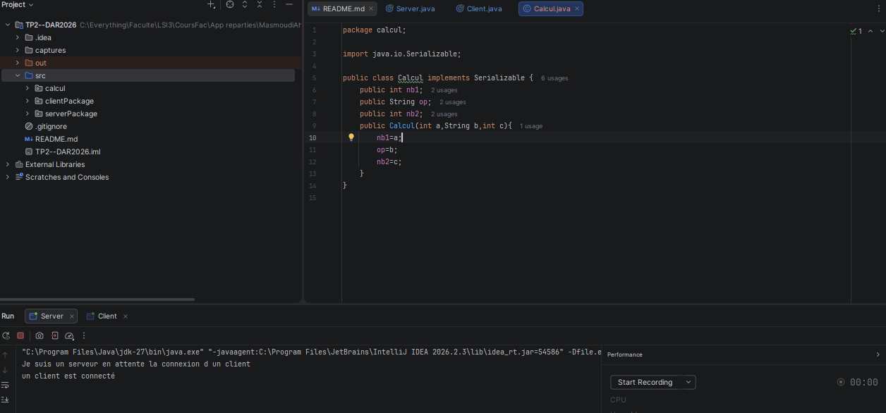

# TP 2 : Les sockets en mode connecté TCP : E/R de CC & objets

Nom :Masmoudi

Prénom : Ahmed
## Activité 2-2 : Échange des objets entre Client/Serveur via les Sockets TCP

## Étape 2 : Implémentation de l’échange d’objets

Cette étape consiste à étendre les applications client/serveur développées dans l’activité précédente en utilisant la sérialisation des objets en Java. Le client envoie un objet contenant les deux opérandes et l’opérateur au serveur, qui effectue le calcul demandé et renvoie le résultat au client pour l’afficher.

