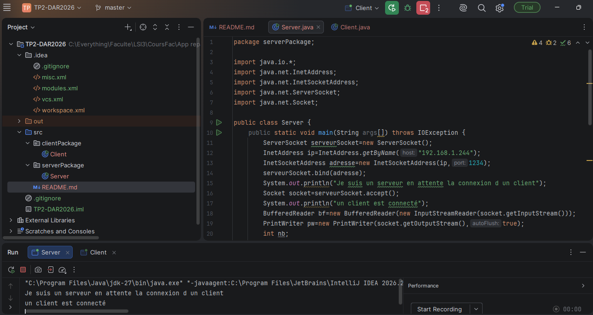
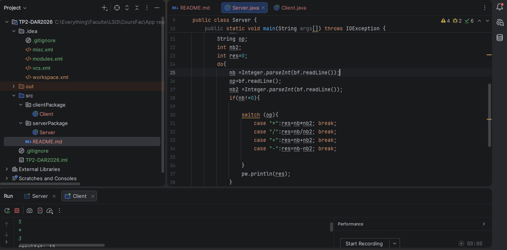
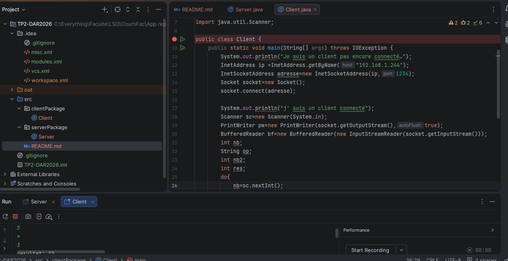
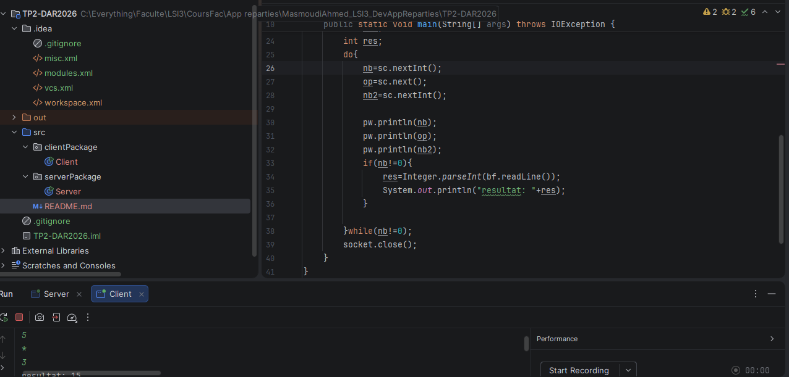

# TP 2 : Les sockets en mode connecté TCP — E/R de CC & objets

**Nom et prénom :** Masmoudi Ahmed

## Activité 2-1 : Échange de CC entre Client/Serveur via les Sockets TCP

## Étape 2 : Application des flux de traitement de CC

Nous avons développé les applications Client et Serveur en Java à l’aide des sockets TCP afin de permettre l’échange de chaînes de caractères contenant les éléments d’une opération complète. Le client envoie le premier opérande, l’opérateur et le deuxième opérande au serveur. Le serveur effectue le calcul demandé, puis renvoie le résultat au client, qui le lit et l’affiche. Nous avons également prévu les opérations arithmétiques de base : addition, soustraction, multiplication et division.

